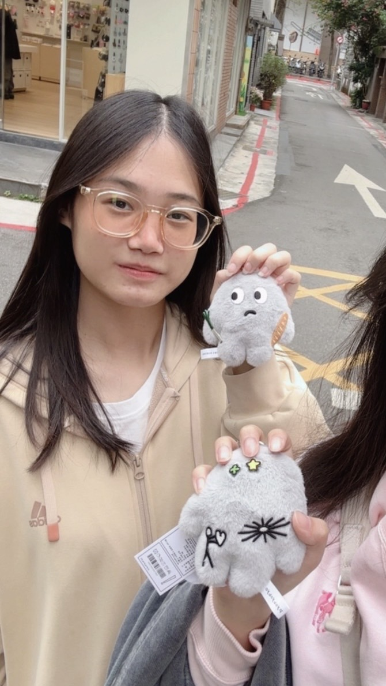
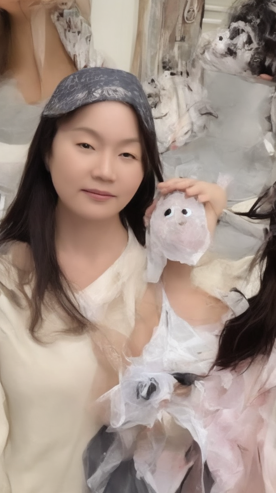
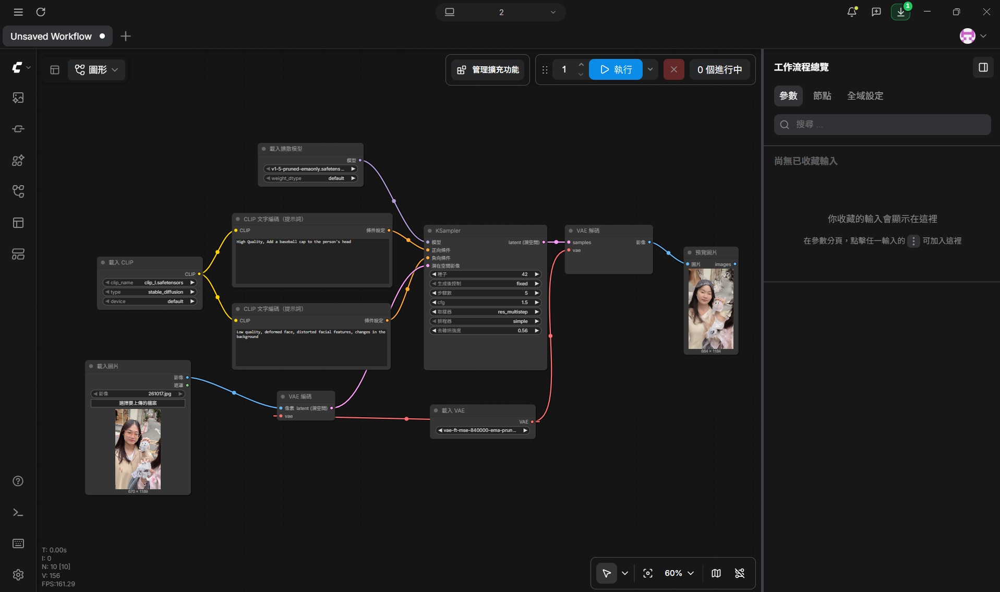
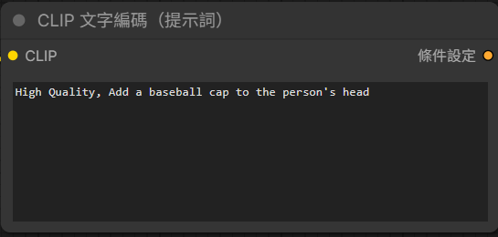
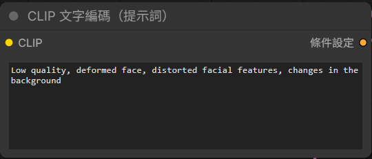

# comfyUI生成圖片
- 原圖

- 生成的圖

- 完整工作流截圖

- 正提示詞

  高畫質，在人物頭上加上棒球帽

- 反提示詞

  低品質，臉部變形、五官扭曲、背景變化

- 個人心得

    生成這張圖的過程非常坎坷，一開始是用「載入檢查點」這個節點的，開始執行後顯示輸入是無效的，我才發現沒有老師教材裡面能直接下載的模型，所以我就去hugging face下載模型，但下載完不知道應該要如何讓它出現在comfy的模型裡，查了很久的資料後建資料夾也失敗，最後是在comfy最上面的存儲找到資料夾才存進去的。而下載完模型卻沒有下拉的選單讓我選擇，所以改用「載入CLIP」和「載入擴散模型」分別建立連線，但執行後又失敗了，我下載的模型和原本的節點不匹配，所以又去下載了標準的SD 1.5 vae 和 clip_l，最後才執行成功的。

    「KSampler」裡的數據我大概調了一點，發現「去雜訊強度」如果接近0的話會越靠近原圖，到0.56的時候還大概能看得出原圖的基礎，且頭上有東西，稍微符合了我要加一頂帽子的需求，不過其他還是被改變了挺多的。